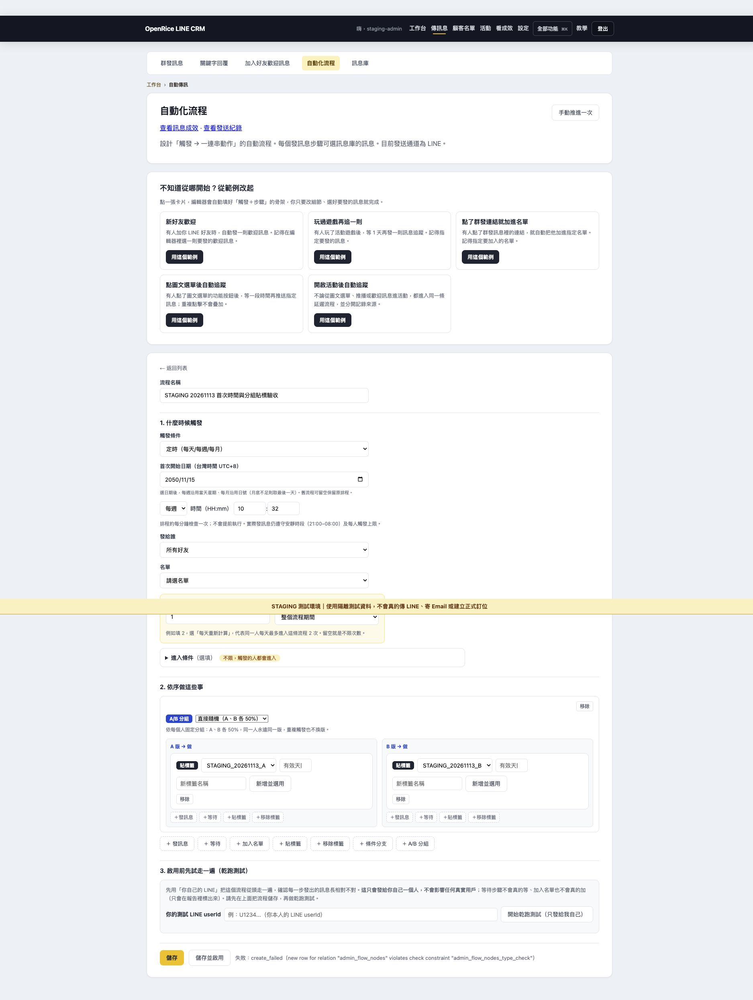
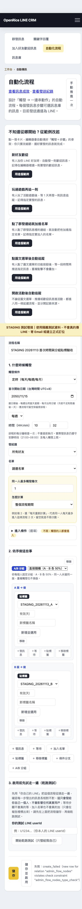

PR title：feat: 自動化流程支援首次啟動時間、流程內新增標籤與 A/B 分組貼標

目前狀態：程式已推送 staging（eee2ce1），固定測試站驗收未通過：保存 A/B 草稿被資料庫 CHECK constraint 擋下，不可核准正式上線。

## 這次要做什麼

讓行銷人員可在流程內新增標籤，並為 A/B 分組設定各自的貼標動作。定時流程可指定台灣時間的首次日期與分鐘，之後依每天／每週／每月重複。

## 改了哪些地方

- 功能／路由：自動化流程編輯、儲存驗證、定時觸發；新增 POST /admin/flows/api/tags。
- 主要檔案：src/routes/adminFlows.js、src/core/flowEngine.js、views/admin_flows.ejs、test/flow-branch-tags.test.js、test/flow-tags-ui.test.js、test/flow-start-time.test.js、docs/AI_HANDOFF.md。
- 用戶路徑：傳訊息 → 自動化流程 → 新增／編輯 → 選定時與首次日期時間 → A/B 分組 → 各分支選標籤或新增並選用 → 儲存。

## 風險與資料

- [x] 不會修改正式資料或 schema
- [ ] 若有 migration，已附上 migration、影響評估與 rollback SQL（程式未改 schema；Staging constraint 相容問題待查，尚未提供／套用 migration）
- [x] 沒有將 token、密碼、LINE User ID、Email 或電話寫入 commit
- [x] 不會誤觸群發、抽獎、邀請、排程或其他 production 寫入（驗收只保存 Staging 草稿，不啟用／乾跑／手動推進）

標籤沿用共用 user_tags，新增後立即存在；同名標籤沿用且不改顏色。A/B 分組沿用既有分組結果，各路徑獨立執行；不會自動移除用戶之前已持有的另一個標籤。排程每分鐘檢查，仍受安靜時段與每人觸發上限限制；「每天重複」不會自動取消預設每人終身 1 次上限。

## 怎麼驗證

- [x] `npm ci --include=dev`
- [x] `npm test`
- [x] `git diff --check origin/main...HEAD`
- [ ] 已在固定 Staging 站實際走過受影響用戶路徑
- [ ] UI 改動已驗證桌機與 390px 手機畫面、console 無錯誤

測試結果：

```text
npm ci --include=dev：exit 0
npm test：674 tests / 674 pass / 0 fail / 0 skipped
涵蓋：分支標籤保存與重載、無效素材 ID、同名標籤、執行不串分支、
非同步新增時保留其他編輯、刪除步驟後舊回應、首次日期／分鐘、跨午夜期別。
固定 Staging：新版日期、分鐘、A/B 標籤選擇器已呈現。
流程內成功建立 STAGING_20261113_A / B，兩分支可分別選用。
但儲存回傳 create_failed：違反 admin_flow_nodes_type_check。
重新載入確認沒有新增草稿，交易已回滾。儲存／重載驗收未通過。
390px：innerWidth=390、scrollWidth=375；編輯器元素未超出右邊界。
console 捕捉無 error，但 API 已明確回報儲存失敗，不能據此判定功能通過。
真人發送／實際等待排程到時：未執行；未驗證 LINE 實收。
```

## 畫面證據

固定 Staging：https://staging--openrice-line-crm.netlify.app/admin/flows





### 尚待處理

請有資料庫權限的同事在隔離測試資料庫執行 `scripts/staging/inspect-flow-node-types.sql`（唯讀），提供 constraint definition 結果。此工作區沒有可用資料庫連線或管理工具，因此尚未確認 constraint 究竟拒絕 ab_split、add_tag 或其他類型；不得憑錯誤訊息猜測並放寬正式限制。取得定義後補精確 migration／rollback，再驗證保存、重載與獨立貼標。

## 如何回滾

在 staging 對功能 commit `eee2ce1` 執行 git revert，通過測試後正常推送 staging。無 schema 變更，無 rollback SQL。若將來發布正式，須由 Hen 核准並循既有發布流程回滾，不直接 push main。回滾前先暫停依賴本次首次日期或分支標籤的新流程，避免舊版忽略首次日期；本次驗收草稿保持未啟用。新增的共用標籤不隨程式回滾刪除。

## Hen 核准

- [ ] Hen 已確認固定 Staging 與上述風險
